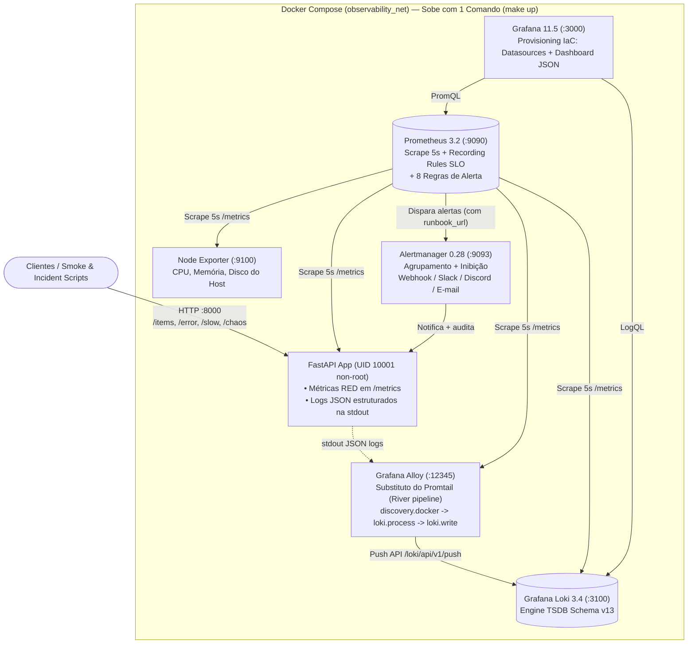

# Projeto 4 · Observabilidade Cloud-Native, SLOs e Error Budget

[](https://github.com/Gabriel-V-Mendes/Observabilidade/actions/workflows/ci.yml)

Plataforma completa de **Observabilidade e Engenharia de Confiabilidade (SRE)** construída com **FastAPI instrumentada (Métricas RED + Logs JSON)**, **Prometheus**, **Node Exporter**, **Grafana Loki (`v3.4.2`, TSDB v13)**, **Grafana Alloy (`v1.7.1`, substituto oficial do Promtail)**, **Alertmanager** e **Grafana** provisionado 100% como código.

---

## 1. Problema (Antes vs Depois)

A primeira versão deste repositório (`commit 0064d1f`) demonstrava o básico de coleta, mas possuía lacunas críticas para operação real de SRE em 2026:

| Sintoma na versão antiga (`0064d1f`) | Consequência prática | Como foi resolvido |
|---|---|---|
| Usava **Promtail** (`grafana/promtail:latest`) lendo `/var/lib/docker/containers` | O Promtail foi **depreciado no Loki 3.7 e descontinuado** em favor do coletor unificado **Grafana Alloy** | Substituído por **Grafana Alloy (`v1.7.1`)** com pipeline declarativo River ([`monitoring/alloy/config.alloy`](monitoring/alloy/config.alloy)) descobrindo containers via Docker socket e extraindo campos JSON |
| Sem documentação/manifests da mudança do chart do Loki em 2026 | Em **16/03/2026**, o chart OSS do Loki saiu de `grafana/loki` (congelado na `v6.55.0` para uso exclusivo do *Grafana Enterprise Logs*) | Criado [`kubernetes/`](kubernetes/) documentando e configurando o novo repositório oficial **`grafana-community/loki`** (`oci://ghcr.io/grafana-community/helm-charts/loki`) + `grafana/alloy` |
| Todas as imagens usavam tag `:latest` e não tinham `healthcheck` nem limites de recursos | Builds não reprodutíveis e impossibilidade de usar `docker compose up --wait` | Imagens fixadas por versão (`v3.2.1`, `v1.9.0`, `v0.28.0`, `3.4.2`, `v1.7.1`, `11.5.2`), limites de CPU/RAM e healthchecks em todos os serviços |
| Métricas sem contador explícito de erros, buckets padrão e vulnerável a explosão de cardinalidade | Rotas `404` aleatórias criavam milhares de séries no Prometheus; faltava alerta de **Latência p95** e de **Queima de Error Budget (Burn Rate)** | Instrumentação **RED** completa em [`app/src/main.py`](app/src/main.py) com normalização de rotas, buckets alinhados aos SLOs (`0.3s` e `0.5s`) e **Recording Rules** de Burn Rate (`14.4x` e `2.0x`) |
| Alertas sem Runbook (`runbook_url`) e sem Post-Mortem | *"Alerta sem ação é ruído"*: o plantonista recebia a notificação sem procedimento padronizado de diagnóstico e mitigação | Todas as **8 regras de alerta** possuem `runbook_url` validado no CI apontando para [`docs/runbooks/`](docs/runbooks/), além do Post-Mortem [`INC-001`](docs/post-mortem/INC-001-api-outage-burn-rate.md) |
| Zero testes automatizados e zero pipeline de CI | Alterações quebravam regras PromQL ou a API silenciosamente | Suíte `pytest` (`95.8%` de cobertura), validação com `promtool` e `amtool`, scan `gitleaks` e pipeline E2E em [`.github/workflows/ci.yml`](.github/workflows/ci.yml) |

**Critérios de pronto atendidos:**
- [x] **Promtail trocado por Grafana Alloy** e instalação atualizada do **Loki (2026)** documentada em [`kubernetes/README.md`](kubernetes/README.md).
- [x] **API instrumentada (RED: Taxa, Erros, Duração)** + **Prometheus** + **Node Exporter** + **Dashboards versionados no Git**.
- [x] **SLOs e Error Budget definidos** com alertas de **Burn Rate (Fast/Slow)**, **Taxa de Erro**, **Latência p95 (< 300ms)**, **Latência p99 (< 500ms)** e **Queda de Componente (`TargetDown`)**.
- [x] **Componente derrubado de propósito (`make incident`)** com medição automatizada do **Tempo de Detecção (TTD)** e **Tempo de Recuperação (TTR)**.
- [x] **Post-mortem escrito** ([`docs/post-mortem/INC-001-api-outage-burn-rate.md`](docs/post-mortem/INC-001-api-outage-burn-rate.md)) e **Runbook para cada alerta** ([`docs/runbooks/`](docs/runbooks/)).

---

## 2. Arquitetura



### Estrutura do Repositório

```text
.
├── .github/workflows/ci.yml                # Pipeline CI: Gitleaks + Ruff + Pytest + promtool + amtool + E2E
├── Makefile                                # Atalhos: make up, down, test, lint, smoke, incident, secrets
├── docker-compose.yml                      # Stack completa com healthchecks, limites de recursos e versões fixas
├── .env.example                            # Variáveis de ambiente documentadas (zero segredos no Git)
├── app/
│   ├── Dockerfile                          # Multi-stage, Python 3.12-slim, sem pip, UID 10001, HEALTHCHECK
│   ├── requirements.txt                    # Dependências de produção fixadas
│   ├── requirements-dev.txt                # Pytest, pytest-cov, httpx, ruff
│   ├── src/main.py                         # FastAPI instrumentada (RED metrics, JSON logs, /chaos, /webhook/alerts)
│   └── tests/test_api.py                   # Testes unitários e de instrumentação (>95% cobertura)
├── monitoring/
│   ├── alloy/config.alloy                  # Pipeline Grafana Alloy (substitui o antigo Promtail)
│   ├── loki/loki-config.yml                # Configuração Loki 3.4+ (TSDB schema v13 + retenção 7d)
│   ├── prometheus/
│   │   ├── prometheus.yml                  # Scrape de 5s nos 6 serviços da stack
│   │   ├── recording_rules.yml             # Pré-cálculo de SLIs, Error Budget Restante e Burn Rate (1m/5m)
│   │   └── alerts.yml                      # 8 alertas (Burn Rate, Erro, p95, p99, TargetDown, Host) com runbook_url
│   ├── alertmanager/alertmanager.yml       # Roteamento por severidade, inibição e templates Slack/Discord/Email
│   └── grafana/
│       ├── provisioning/datasources.yml    # Prometheus (uid: prometheus) e Loki (uid: loki) como código
│       ├── provisioning/dashboards.yml     # Provider automático de dashboards
│       └── dashboards/api-dashboard.json   # Dashboard de SLOs, Burn Rate, RED, Host e Logs do Alloy/Loki
├── kubernetes/
│   ├── README.md                           # Documentação da mudança do chart do Loki em mar/2026 + Alloy
│   ├── loki-values.yaml                    # Values para oci://ghcr.io/grafana-community/helm-charts/loki
│   └── alloy-values.yaml                   # Values para grafana/alloy (DaemonSet Kubernetes)
├── scripts/
│   ├── smoke-test.sh                       # Valida todos os componentes, métricas, logs no Loki e runbooks
│   └── simulate-incident.sh                # Provoca queima de budget + queda da API e cronometra TTD e TTR
└── docs/
    ├── slo-specification.md                # Definição formal dos SLIs, SLOs, matemática de Burn Rate e política
    ├── post-mortem/
    │   └── INC-001-api-outage-burn-rate.md # Post-mortem completo com linha do tempo real, 5 Porquês e ações
    └── runbooks/                           # 1 runbook acionável para cada grupo de alerta
        ├── target-down.md
        ├── error-budget-burn.md
        ├── high-error-rate.md
        ├── high-latency.md
        └── host-resources.md
```

---

## 3. O que mudou em 2026: Promtail → Grafana Alloy e Novo Repositório Helm do Loki

### 3.1 Por que o Promtail foi substituído pelo Grafana Alloy?
O **Promtail** entrou em depreciação no Loki `3.7` e foi sucedido pelo **Grafana Alloy**, o coletor unificado da Grafana Labs baseado no **OpenTelemetry Collector** com sintaxe declarativa **River** ([`monitoring/alloy/config.alloy`](monitoring/alloy/config.alloy)).
Enquanto o Promtail coletava apenas logs, o Alloy descobre containers nativamente via `discovery.docker`, aplica relabeling (`discovery.relabel`), processa JSON estruturado (`loki.process`), envia logs ao Loki (`loki.write`) e expõe uma UI própria de inspeção de pipeline em `http://localhost:12345`.

### 3.2 Mudança do Repositório Oficial do Chart do Loki (Março de 2026)
Em **16 de março de 2026**, o chart Helm open-source do Loki deixou de ser publicado em `https://grafana.github.io/helm-charts` (onde parou na versão **`v6.55.0`**, ficando restrito ao *Grafana Enterprise Logs*) e migrou para o repositório **`grafana-community/helm-charts`** (com suporte direto a artefatos OCI no GHCR).

Comandos atuais para Kubernetes (detalhes completos e values prontos em [`kubernetes/README.md`](kubernetes/README.md)):

```bash
# 1. Instalar Loki OSS pelo novo registro OCI oficial (2026+):
helm upgrade --install loki oci://ghcr.io/grafana-community/helm-charts/loki \
  --namespace monitoring --create-namespace \
  -f kubernetes/loki-values.yaml --wait

# 2. Instalar Grafana Alloy como DaemonSet coletor de logs:
helm repo add grafana https://grafana.github.io/helm-charts
helm repo update
helm upgrade --install alloy grafana/alloy \
  --namespace monitoring \
  -f kubernetes/alloy-values.yaml --wait
```

---

## 4. Como Subir Tudo com Um Único Comando

Pré-requisitos: Docker com Compose v2.

```bash
make up     # ou: docker compose up -d --build --wait
```

O flag `--wait` aguarda todos os containers passarem nos healthchecks antes de liberar o terminal.

| Serviço | URL Local | Credenciais / Finalidade |
|---|---|---|
| **FastAPI App (`/docs` e `/metrics`)** | http://localhost:8000/docs | API instrumentada (RED + Chaos + Webhook de alertas) |
| **Grafana (Dashboard SLO & Logs)** | http://localhost:3000 | `admin` / `admin` (Dashboard provisionado na pasta *SRE & SLOs*) |
| **Prometheus (Targets, Rules & Alerts)** | http://localhost:9090/alerts | Inspeção de SLIs, Recording Rules e estado dos alertas |
| **Grafana Alloy UI (Pipeline de Logs)** | http://localhost:12345 | Visualização ao vivo dos componentes River (`discovery.docker` → `loki.write`) |
| **Alertmanager** | http://localhost:9093 | Agrupamento, silêncio e roteamento de alertas |
| **Loki Readiness** | http://localhost:3100/ready | API de ingestão e consulta LogQL |
| **Node Exporter** | http://localhost:9100/metrics | Métricas de CPU, memória, disco e rede do host |

Para validar que todos os 7 serviços, métricas RED, logs no Loki via Alloy, dashboard no Grafana e runbooks estão funcionando:

```bash
make smoke
```

---

## 5. Definição de SLIs, SLOs, Error Budget e Regras de Alerta

A especificação completa encontra-se em [`docs/slo-specification.md`](docs/slo-specification.md).

### 5.1 Objetivos de Nível de Serviço (SLOs)

| Indicador (SLI) | Meta (SLO) | Error Budget (Janela de 30 dias) | Recording Rule no Prometheus |
|---|---|---|---|
| **Disponibilidade** (requisições sem erro `5xx`) | **`>= 99.5%`** | **`0.5%`** (~`216 minutos` de indisponibilidade em 30 dias) | `job:sli_availability:percent1m` e `job:slo_error_budget_remaining:percent5m` |
| **Latência p95** | **`< 300 ms`** (`0.300s`) | 5% das requisições podem superar `300 ms` | `job:sli_latency_p95:seconds1m` |
| **Latência p99** | **`< 500 ms`** (`0.500s`) | 1% das requisições podem superar `500 ms` | `job:sli_latency_p99:seconds1m` |

### 5.2 Catálogo de Alertas e Runbooks ("Alerta sem ação é ruído")

Todas as regras estão declaradas em [`monitoring/prometheus/alerts.yml`](monitoring/prometheus/alerts.yml) e possuem validação obrigatória de `runbook_url` no CI:

| Alerta | Condição PromQL | `for` | Severidade | Runbook Acionável |
|---|---|---|---|---|
| **`TargetDown`** | `up{job=~"fastapi-app\|node-exporter\|loki\|grafana-alloy"} == 0` | `10s` | `critical` | [`docs/runbooks/target-down.md`](docs/runbooks/target-down.md) |
| **`SLOErrorBudgetBurnFast`** | `job:slo_error_burn_rate:ratio_rate1m > 14.4` (taxa 5xx > 7.2%) | `15s` | `critical` | [`docs/runbooks/error-budget-burn.md`](docs/runbooks/error-budget-burn.md) |
| **`SLOErrorBudgetBurnSlow`** | `job:slo_error_burn_rate:ratio_rate5m > 2.0` (taxa 5xx > 1.0%) | `1m` | `warning` | [`docs/runbooks/error-budget-burn.md`](docs/runbooks/error-budget-burn.md) |
| **`HighErrorRate`** | `job:slo_error_ratio:rate1m > 0.01` (erros 5xx > 1%) | `20s` | `critical` | [`docs/runbooks/high-error-rate.md`](docs/runbooks/high-error-rate.md) |
| **`HighLatencyP95`** | `job:sli_latency_p95:seconds1m > 0.300` (`> 300ms`) | `20s` | `warning` | [`docs/runbooks/high-latency.md`](docs/runbooks/high-latency.md) |
| **`HighLatencyP99`** | `job:sli_latency_p99:seconds1m > 0.500` (`> 500ms`) | `20s` | `critical` | [`docs/runbooks/high-latency.md`](docs/runbooks/high-latency.md) |
| **`HighHostCPU`** | Uso médio de CPU do host `> 85%` | `2m` | `warning` | [`docs/runbooks/host-resources.md`](docs/runbooks/host-resources.md) |
| **`HighDiskUsage`** | Ocupação da partição `/` `> 80%` | `5m` | `warning` | [`docs/runbooks/host-resources.md`](docs/runbooks/host-resources.md) |

---

## 6. Incidente Provocado, Medição de TTD/TTR e Post-Mortem

Para provocar o incidente automatizado (Fase 1: queima rápida de Error Budget + Fase 2: queda proposital do container `fastapi-app` com medição em segundos do tempo até detecção e recuperação):

```bash
make incident     # ou: ./scripts/simulate-incident.sh
```

Saída real da execução cronometrada na stack:

```text
==================================================================
RESUMO DAS MÉTRICAS DO INCIDENTE PROVOCADO
==================================================================
  • TTD Queima de Budget (SLOErrorBudgetBurnFast -> firing): 32s
  • TTD Queda do Componente (up == 0 -> pending):            9s
  • TTD Queda do Componente (TargetDown -> firing):          19s
  • TTR Recuperação após restart (up == 1):                  8s
==================================================================
```

- **Relatório completo de Post-Mortem:** [`docs/post-mortem/INC-001-api-outage-burn-rate.md`](docs/post-mortem/INC-001-api-outage-burn-rate.md)

---

## 7. Testes, Validação Estática e Segurança

```bash
make lint       # Ruff (Python) + promtool check config/rules + amtool check-config
make test       # Pytest + cobertura mínima de 90% (atual: 95.8%)
make smoke      # Valida API, Prometheus, Alloy->Loki, Alertmanager, Grafana e Runbooks
make incident   # Simula incidente e cronometra TTD (Time to Detect) e TTR (Time to Recovery)
make secrets    # Gitleaks em todo o histórico Git (0 vazamentos)
```

* **Evidência do CI (GitHub Actions):**
  [Run #40609511664 no GitHub Actions](https://github.com/Gabriel-V-Mendes/Observabilidade/actions/runs/40609511664) (todos os jobs `security-and-policy`, `lint-and-validate` e `e2e-observability` aprovados).

---

## 8. Decisões e Trade-offs

| Decisão | Alternativa avaliada | Por quê / Trade-off |
|---|---|---|
| **Grafana Alloy (`v1.7.1`)** no lugar do Promtail | Promtail, Fluent Bit, Vector | O Promtail foi descontinuado no Loki 3.7. O Alloy unifica coleta de logs, métricas e traces (OpenTelemetry) com UI de depuração (`:12345`) e pipeline declarativo River |
| **Loki (`v3.4.2`) com TSDB Schema v13** | Elasticsearch / OpenSearch | O Loki indexa apenas labels de baixa cardinalidade (`container`, `service_name`, `level`, `endpoint`) e comprime o corpo do log em chunks, consumindo ~10x menos RAM que o Elasticsearch |
| **Alertas baseados em Burn Rate do Error Budget** (`14.4x` e `2.0x`) | Apenas limiar fixo de erro instantâneo | Alertar pela velocidade de consumo do orçamento (`0.5%`) evita falsos positivos em micro-oscilações e avisa imediatamente quando um incidente coloca a meta mensal (`99.5%`) em risco |
| **`scrape_interval: 5s` e `evaluation_interval: 5s`** | `15s` ou `30s` | Reduz o Tempo de Detecção (TTD) de quedas para **~15 segundos** no laboratório. Em clusters com milhares de targets, `15s` consome menos CPU/disco no TSDB |
| **Normalização de `endpoint` no middleware da API** | Usar `request.url.path` bruto como label | Impede ataque/acidente de explosão de cardinalidade no Prometheus quando clientes requisitam URLs dinâmicas inexistentes (`/item/12345` vira `/items/{id}` ou `/unknown`) |
| **Receptor Webhook local ativo + Slack/Discord/Email parametrizados** | Hardcodar URL de Webhook no YAML | Mantém `amtool check-config` válido e permite testar o recebimento de alertas no CI (`GET /webhook/alerts`) sem jamais versionar tokens de Slack/Discord no Git |

---

## 9. Custo Estimado

Valores de referência em **outubro/2026** (sem impostos):

| Cenário | Infraestrutura | Custo Mensal Estimado | Observação |
|---|---|---|---|
| **1. Execução Local (`docker compose`)** | 7 containers locais com limites somados de ~1,8 GB de RAM (uso real em repouso: ~420 MB) | **US$ 0,00 / mês** | Custo zero para desenvolvimento, estudo e validação de incidentes |
| **2. CI/CD (GitHub Actions em repo público)** | Jobs `security-and-policy`, `lint-and-validate` e `e2e-observability` | **US$ 0,00 / mês** | Runners Ubuntu gratuitos para repositórios públicos |
| **3. VPS Dedicada de Monitoramento (Hetzner CX23 / 4 GB RAM)** | 2 vCPU, 4 GB RAM, 40 GB NVMe rodando toda a stack Docker Compose com retenção de 7–15 dias | **≈ € 5,99 / mês (~US$ 6,50)** | Suficiente para monitorar dezenas de serviços pequenos sem custo por GB ingerido |
| **4. Grafana Cloud (Free Tier vs Pro)** | Até 10k séries Prometheus + 50 GB de logs Loki + 3 usuários | **US$ 0,00 / mês** (Free Tier) | Acima da franquia: ~US$ 0,50/GB de logs ingeridos e ~US$ 8 por 1k séries ativas |

---

## 10. O que eu faria diferente

1. **Rastreamento Distribuído (Distributed Tracing) com Grafana Tempo + OpenTelemetry SDK:** hoje correlacionamos métricas (Prometheus) e logs estruturados (Loki) via `request_id`. Como o **Grafana Alloy** já é nativamente compatível com OTLP (`otelcol.receiver.otlp`), o próximo passo natural seria instrumentar a FastAPI com `opentelemetry-instrumentation-fastapi` enviando spans para o **Grafana Tempo**, habilitando *Exemplars* (clicar num ponto de latência p99 no gráfico e abrir o trace exato).
2. **Armazenamento de Objetos (S3 / MinIO) para Loki e Thanos/Mimir no Prometheus:** no Compose local usamos volumes de disco com retenção de 7 dias. Em produção, apontaria o Loki e o Prometheus (via Thanos ou Grafana Mimir) para buckets S3 com política de lifecycle para retenção de longo prazo (90–365 dias) a baixo custo.
3. **Multi-Window Multi-Burn-Rate Completo (1h/5m e 6h/30m):** reduzimos as janelas para `1m` e `5m` para permitir demonstração e medição prática de incidentes em segundos durante o `make incident`. Em produção real com tráfego 24/7, utilizaria os pares canônicos do livro *Google SRE Workbook* (`1h + 5m` para `14.4x` e `6h + 30m` para `6x`) para evitar páginas por picos de menos de 2 minutos.
4. **Autenticação OAuth2 / OIDC no Grafana e TLS reverso:** substituir a credencial local (`admin`/`admin`) por SSO corporativo (GitHub/Google OAuth) e expor apenas o Grafana via proxy TLS.
5. **Testes Contínuos de Sintéticos (Blackbox Exporter):** adicionar o `prometheus/blackbox_exporter` testando a API de fora para dentro (HTTP/TLS/DNS) para medir disponibilidade na perspectiva externa mesmo quando a API inteira trava.
